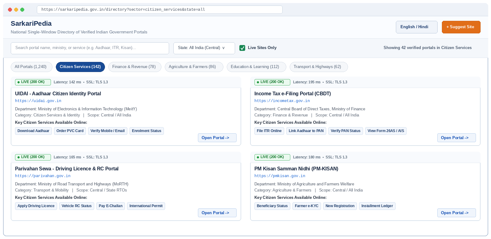

# 🏛️ SarkariPedia

[](https://python.org)
[](https://flask.palletsprojects.com/)
[](https://sqlite.org)
[](https://www.docker.com/)
[](LICENSE)
[](docs/SarkariPedia_Mini_Project_Report.pdf)

> **National Single-Window Directory, Ethical Web Harvester, and Real-Time Health-Monitoring Search Engine for Indian Government Portals.**

SarkariPedia aggregates, categorizes, and verifies thousands of official Indian government services (`.gov.in`, `.nic.in`, `.gov`, `sansad.in`) in one fast, bilingual, mobile-first web directory.

---

## 📸 Illustrative Interface



---

## ✨ Key Features

* **🇮🇳 Single Window Public Access**: Direct access to Central ministries and 36 States/UTs without ad-monetized intermediaries or predatory clone sites.
* **🌐 Bilingual Interface**: Instant Hindi/English UI toggle with zero page reloads.
* **⚡ Instant Debounced Search**: Fast search across portal titles, department names, ministries, and domain keywords with a 280ms debounce.
* **🤖 Ethical RFC 9309 Crawler**: Polite Breadth-First Search (BFS) crawler respecting `robots.txt`, enforcing a 1.2s inter-request rate limit, and strictly whitelisting official public TLDs.
* **🏷️ Deterministic Heuristic Classifier**: Two-tier rule engine mapping endpoints into 15 functional sectors and state jurisdictions with zero cloud LLM latency.
* **🩺 Real-Time Health Daemon**: Asynchronous multi-threaded HTTP HEAD/GET probes monitoring server uptime with a 3-strike failure escalation rule.
* **🐳 Production Docker Containerization**: Lightweight Alpine-based multi-stage Docker setup with Docker Compose orchestration.
* **🎓 Complete Academic Deliverables**: Complete 33-page AKTU B.Tech Mini Project Report available in PDF, Microsoft Word (`.docx`), and Markdown formats under `docs/`.

---

## 📂 Project Architecture & Organization

```
SArkariPedia/
├── app/                                # Web Application & REST API
│   ├── static/                         # Single-page UI (HTML5, Vanilla CSS, JS)
│   │   └── index.html                  # Responsive bilingual citizen directory
│   ├── __init__.py
│   ├── db.py                           # SQLite connection pool & WAL mode helpers
│   └── main.py                         # REST API endpoints & Flask application
│
├── scraper/                            # Web Crawling & Classification Engine
│   ├── __init__.py
│   ├── crawl.py                        # RFC 9309 ethical BFS crawler & health monitor
│   ├── classify.py                     # Two-tier deterministic heuristic classifier
│   ├── seeds.csv                       # Curated initial government portal seeds
│   └── sources.json                    # Directory source endpoints & category rules
│
├── scripts/                            # Operational & Automation Utilities
│   └── weekly_refresh.sh               # Cron job for periodic crawling & health checks
│
├── docs/                               # Comprehensive Project & Academic Documentation
│   ├── SarkariPedia_Mini_Project_Report.pdf   # 33-Page AKTU B.Tech Mini Project Report
│   ├── SarkariPedia_Mini_Project_Report.docx  # Word Document version with full styles
│   ├── SarkariPedia_Mini_Project_Report.html  # Standalone printable HTML report
│   ├── SarkariPedia_Mini_Project_Report.md    # Master Markdown project specification
│   ├── diagrams/                              # All 14 high-resolution 300 DPI figures
│   │   ├── fig_1_3_1.png               # Structural Pipeline
│   │   ├── fig_1_4_1.png               # Agile Development Lifecycle
│   │   ├── fig_1_4_2.png               # Crawler Flowchart
│   │   ├── fig_2_3_1.png               # Docker Deployment Architecture
│   │   ├── fig_3_1_2.png               # Requirement Engineering Cycle
│   │   ├── fig_4_1_1.png               # 3-Tier Layered Architecture
│   │   ├── fig_4_3_2.png               # Database Entity-Relationship Diagram
│   │   ├── fig_4_4_1.png               # Level 0 Data Flow Diagram (DFD)
│   │   ├── fig_4_4_2.png               # Level 1 Data Flow Diagram (DFD)
│   │   ├── fig_4_5_1.png               # Use Case Diagram
│   │   ├── fig_4_6_1.png               # Heuristic Classification Decision Tree
│   │   ├── fig_5_5_1.png               # High-Resolution Web UI Interface Mockup
│   │   ├── fig_5_6_1.png               # Gantt Implementation Schedule
│   │   └── fig_6_2_1.png               # Agile Testing Cycle
│   ├── build_report.py                 # PDF compilation script
│   ├── build_docx.py                   # DOCX compilation script
│   ├── generate_diagrams.py            # High-resolution diagram builder
│   ├── Project_Plan.pdf                # Original project blueprint document
│   └── references/                     # External formatting references
│
├── data/                               # Persistent Storage Directory
│   └── gov_sites.db                    # Seeded & verified SQLite database
│
├── .gitignore                          # Standard Git ignore rules
├── Dockerfile                          # Multi-stage production container build
├── docker-compose.yml                  # One-command compose deployment
├── requirements.txt                    # Python dependencies
└── README.md                           # Project documentation
```

---

## 🚀 Quick Start

### 1. Local Development (Python 3.11+)

```bash
# Clone the repository
git clone https://github.com/Saurabh27srb/SArkariPedia.git
cd SArkariPedia

# Create and activate virtual environment
python3 -m venv .venv
source .venv/bin/activate

# Install dependencies
pip install -r requirements.txt

# Start the Flask API server
python3 -m app.main
```

Open your browser at `http://localhost:8000` to browse portals.

---

### 2. Docker Compose Deployment

```bash
# Build and run the web application container
docker compose up -d api

# Run crawler commands inside container
docker compose run --rm worker python -m scraper.crawl seed
docker compose run --rm worker python -m scraper.crawl check
```

---

## 🕷️ Crawler & Harvester CLI

The scraping module provides fine-grained subcommands:

```bash
# Load initial verified seed sites into SQLite
python3 -m scraper.crawl seed

# Harvest directory portals from sources.json
python3 -m scraper.crawl crawl

# Execute parallel health-checks on all portals
python3 -m scraper.crawl check

# Deduplicate domains, normalize URLs, re-classify 'Other'
python3 -m scraper.crawl clean

# Run complete pipeline (seed + crawl + check + clean)
python3 -m scraper.crawl all

# Print database statistics summary
python3 -m scraper.crawl stats
```

---

## 🌐 RESTful API Endpoints

| Method | Endpoint | Description |
|--------|----------|-------------|
| `GET` | `/api/health` | Service status, database connectivity, and portal counts |
| `GET` | `/api/categories` | 15 functional sectors with active portal counts |
| `GET` | `/api/states` | 36 States and Union Territories with portal counts |
| `GET` | `/api/sites` | Filtered portal query (supports `q`, `category`, `state`, `live`, `page`, `size`) |
| `POST` | `/api/suggest` | User submission of new official government portals |
| `POST` | `/api/report` | User report for broken or unreachable links |

### `/api/sites` Query Parameters

| Parameter | Type | Default | Description |
|-----------|------|---------|-------------|
| `q` | string | `""` | Search query matching portal name, department, or domain |
| `category` | string | `""` | Filter by 15 functional sectors |
| `state` | string | `""` | Filter by Indian state / UT (e.g., `Uttar Pradesh`, `Delhi`) |
| `live` | integer | `0` | `1` to return only verified active portals (HTTP 200) |
| `page` | integer | `1` | Pagination page number |
| `size` | integer | `50` | Results per page (maximum: 200) |

---

## ⏰ Automated Weekly Refresh (Cron)

Set up a scheduled cron job to run maintenance every Sunday at 2:00 AM:

```bash
crontab -e
# Add the following entry:
0 2 * * 0 /home/dell/Desktop/govsites/scripts/weekly_refresh.sh
```

---

## 📜 Academic Mini Project Report

The complete academic B.Tech Mini Project Report structured for **Dr. A.P.J. Abdul Kalam Technical University (AKTU)** and **Kanpur Institute of Technology (KIT Kanpur)** is provided in multiple formats:
* **PDF Report**: [`docs/SarkariPedia_Mini_Project_Report.pdf`](docs/SarkariPedia_Mini_Project_Report.pdf) (33 Pages, Vector Layout)
* **Word Document**: [`docs/SarkariPedia_Mini_Project_Report.docx`](docs/SarkariPedia_Mini_Project_Report.docx) (Standard OpenXML)
* **Markdown Document**: [`docs/SarkariPedia_Mini_Project_Report.md`](docs/SarkariPedia_Mini_Project_Report.md)
* **Printable HTML**: [`docs/SarkariPedia_Mini_Project_Report.html`](docs/SarkariPedia_Mini_Project_Report.html)

---

## ⚖️ License & Ethical Disclaimer

Distributed under the **MIT License**.

> **Disclaimer**: SarkariPedia is an independent, open-source educational directory and indexing project. It is **not** an official government entity. All external links point directly to official government domains (`.gov.in`, `.nic.in`, `.gov`, `sansad.in`). SarkariPedia does not collect, process, or store personal citizen data or credentials.
